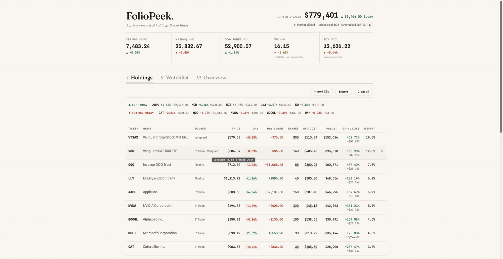
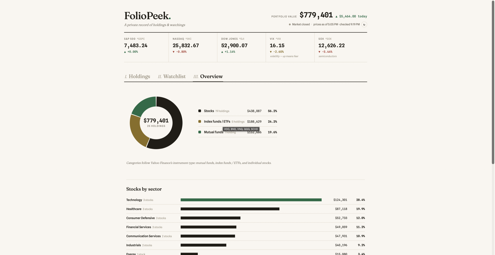

# FolioPeek

**A portfolio tracker that never sees your portfolio.** No account, no broker
login, no cloud — one Python file serves a local page, your holdings live in
your own browser, and the only thing that ever leaves your machine is a stock
quote request. Peek at your portfolio without logging into your brokers.



*All data shown is a demo portfolio generated from sample CSVs.*

## Why

Most portfolio trackers want your brokerage credentials (through aggregators
like Plaid) or want your holdings in their cloud. FolioPeek refuses both. You
import a positions CSV from your broker — or type holdings in by hand — and
the data stays in your browser's local storage, mirrored to a JSON file on
your own disk. It is **view-only by design**: track, don't trade.

## What is read — and what never is

**Your account information and personal information are never read, saved,
or transmitted. Anywhere. By anything in this codebase.**

| | |
|---|---|
| **Read from a broker CSV** | Exactly three columns: ticker, share count, average cost. The parser looks for those columns and no others. |
| **Never read** | Account numbers, account owner names, balances, transaction history, or any other column — they are skipped during parsing, and the file itself is discarded after the review screen; it is never stored, never uploaded. |
| **Saved (on your machine only)** | Tickers, share counts, optional avg cost, the source label you choose, and a daily total-value snapshot — in your browser's localStorage and a backup JSON on your own disk. |
| **Sent over the internet** | Ticker symbols to Yahoo Finance for quotes — nothing else. No accounts, no sign-up, no analytics, no telemetry; even the fonts are bundled locally so the page makes **zero third-party requests**. |

Don't take the README's word for it: the code is small enough to check —
`app.js` (parsing, storage) and `server.py` (the only network egress) are a
few hundred readable lines each.

## Run

```sh
python3 server.py
```

Opens http://127.0.0.1:8742 (any port: `python3 server.py 9000`).
Requires only Python 3 — no pip install, no Docker, no database.
Developed on macOS; expected to work on Linux and Windows.

To stop: **Ctrl-C**, or if it's in the background: `lsof -ti :8742 | xargs kill`.

## What's on the page

- **Index strip** — S&P 500, NASDAQ, Dow Jones, VIX (colored neutrally — up
  means fear, not good news) and SOX semiconductors, with day change.
- **Movers strip** — your top 5 and bottom 5 holdings by today's % change,
  each with its dollar impact on your portfolio; click one to jump to its row.
- **Holdings** — sortable table with price, day change, day's gain, shares,
  optional avg cost, market value, gain/loss, and portfolio weight. Click the
  dashed **shares** or **avg cost** values to edit them inline. Avg cost is
  optional per row; rows without it simply skip gain/loss.
- **Watchlist** — stocks you're curious about but don't own, with 52-week
  range. Click **＋own** when you buy one to move it into Holdings.
- **Overview** — asset-class donut, sector breakdown of your individual
  stocks, and a chart of your total value over time (one snapshot per day the
  page is opened).



## Importing your broker's CSV

Export a *positions* CSV from your brokerage and click **Import CSV**.
Per-broker instructions (Vanguard, E*Trade, Fidelity, Schwab, Merrill,
Interactive Brokers, and what to do about Robinhood/Webull) are in
**[docs/BROKERS.md](docs/BROKERS.md)**.

Only the ticker, share count and average-cost columns are read — account
numbers, names and balances are ignored, and the file itself is never stored
or uploaded. A review screen shows exactly what was read and what applying it
will change, before anything is applied.

Lot-level exports (like Vanguard's cost basis download, one row per tax lot)
are aggregated automatically: shares summed, cost share-weighted. Class-share
tickers are normalized to Yahoo's form (`BRK.B` / `BRK B` → `BRK-B`).

**Multiple brokerages:** every import is tagged with a source name.
Re-importing a source replaces only that source's rows — never double-counts
— so a weekly refresh is: export from each broker, import each under its own
name. A ticker held at two brokers shows as one row with combined shares and
weighted cost (hover the Source column for the per-source breakdown). If a
file contains a ticker you'd also added manually, the review screen asks, per
ticker, whether to keep both or let the file's row replace your manual one.

`sample_positions.csv` is a fake Fidelity-style export you can use to try it.

## Best practices

The rule that makes everything predictable: **a row tagged with a brokerage
belongs to that brokerage's next import.**

| You want… | Do this |
|---|---|
| Weekly refresh | Export a fresh CSV from each broker and import it — same source name every time |
| Record a buy the broker's file will eventually include | Edit the row inline, or add it with source = that broker; the next *fresh* import absorbs it |
| A position that must survive every import | Add it under source = **Manual** — imports never touch Manual rows unless you say so |
| Import a file containing a ticker you added manually | The review screen flags it and asks, per ticker: keep both (shares combine) or let the file's row replace your manual one |
| Fix a wrong number | Prefer re-exporting a fresh file over hand-editing; the broker's file is the source of truth |

Safety nets: the review screen recognizes which account a file belongs to by
its tickers and states exactly what Apply will do; replacing a source the
file barely overlaps with, or undoing rows you hand-edited since the last
import, each require explicit confirmation.

## Backup & history

Every change is mirrored to `ledger_backup.json` next to `server.py`. If the
browser's localStorage is ever cleared, opening the page offers to restore
from that file. Before the first write of each day, the previous backup is
snapshotted into `backups/` (last 7 days kept) — one bad save can never
destroy your only copy. **Export** downloads your holdings as CSV any time.

## Privacy model

- Your holdings live in your browser's localStorage and in backup files on
  your own disk. Nothing is uploaded anywhere; there are no accounts.
- The broker CSV is parsed in the browser and discarded; only
  ticker / shares / avg cost are kept. Account numbers, owner names and
  balances are never read (see "What is read — and what never is" above).
- The server binds to 127.0.0.1 only. The only outbound traffic is quote
  requests to Yahoo Finance for the tickers on your page — fonts, styles and
  scripts are all served from your own machine, so there are no CDN or
  analytics requests to anyone.
- API requests are rejected unless the Host header is this machine (blocks
  DNS-rebinding reads of the backup), and backup writes require a JSON
  content type (blocks drive-by `no-cors` POSTs from hostile web pages).

## Data source & disclaimers

Quotes come from Yahoo Finance's **unofficial** endpoints, fetched from your
own machine: they are delayed per Yahoo's standard feed, rate-limited per
your own IP, and could change or break without notice. FolioPeek is for
**personal, non-commercial use**, and is **not investment advice** — it's a
private notebook that happens to know stock prices. Quotes auto-refresh every
5 minutes while the tab is visible (every 30 when markets are closed).

## Contributing & support

**FolioPeek is a personal project, maintained in spare time.** Issues and PRs
are welcome — broker CSV formats especially — but responses are best-effort,
and features that require accounts, cloud sync, or trading are out of scope
by design. See [CONTRIBUTING.md](CONTRIBUTING.md).

## License

[AGPL-3.0](LICENSE). In short: use it, change it, share it — but if you
distribute it or host it as a service, your version's source must be open too.
